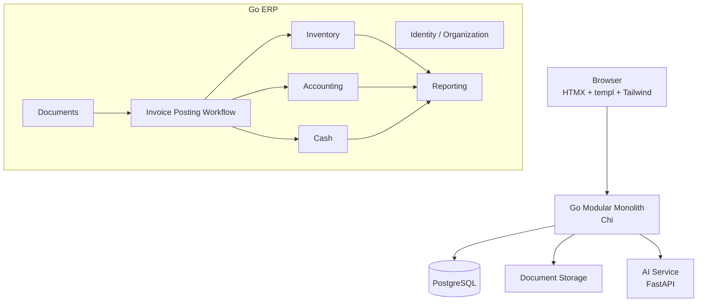
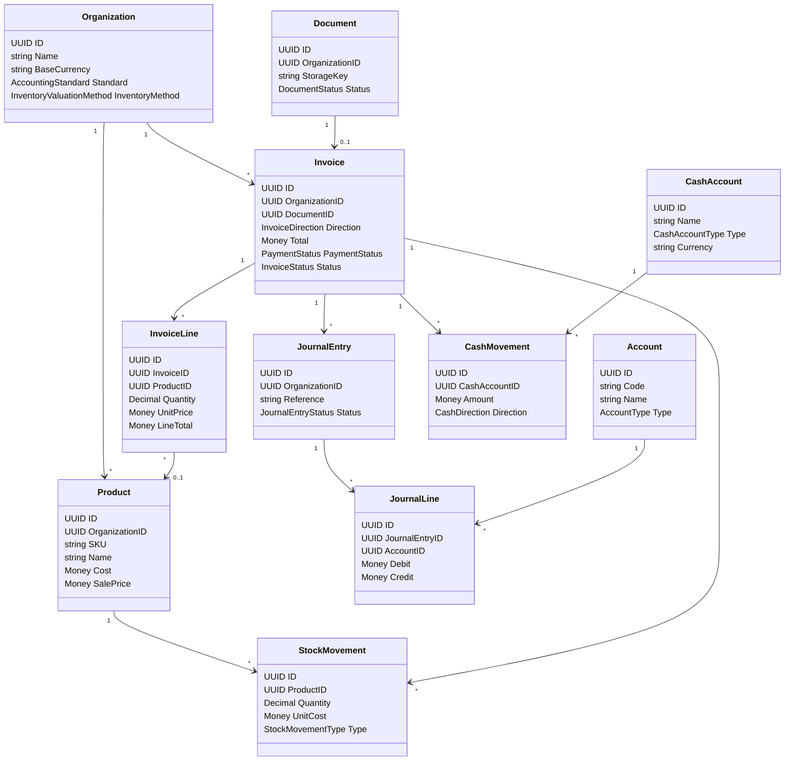
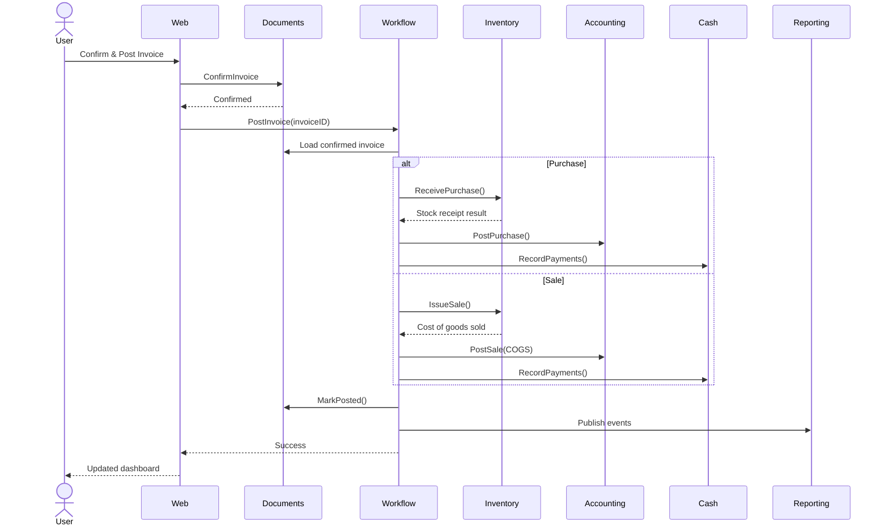
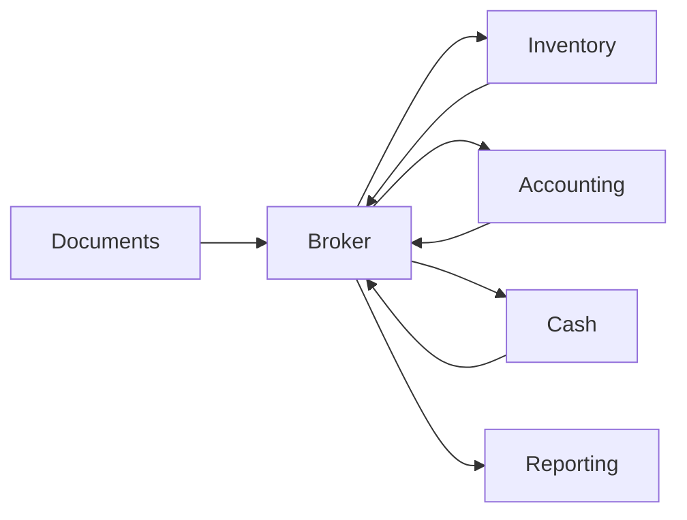

# PanlyackERP — Architecture & Implementation Blueprint

> **Document de référence pour Claude Code, Codex ou tout agent de développement**
>
> Objectif : construire un mini-ERP intelligent, modulaire et évolutif, centré sur la capture de factures par image et l'automatisation des opérations de **stock**, **comptabilité**, **caisse** et **dashboard**.
>
> Nom de travail : **PanlyackERP**  
> Architecture : **Modular Monolith + Hexagonal Architecture**  
> Backend métier : **Go**  
> Frontend : **HTMX + templ + Tailwind CSS**  
> Service IA : **Python + FastAPI**  
> Base de données : **PostgreSQL**  
> Cible initiale : MVP Hackathon / SaaS léger  
> Cible d'évolution : extraction progressive des modules en services indépendants sans réécriture métier.

---

# 1. Vision du produit

PanlyackERP est un mini-ERP **AI-first** et **document-first**.

Contrairement à un ERP classique où l'utilisateur remplit plusieurs formulaires, PanlyackERP utilise les documents déjà produits ou reçus par l'entreprise comme point d'entrée principal.

Le scénario principal est :

```text
Photo d'une facture
        ↓
Extraction IA
        ↓
Validation utilisateur
        ↓
Interprétation de l'opération
        ↓
┌─────────────┬─────────────────┬──────────────┐
│   STOCK     │ COMPTABILITÉ    │    CAISSE    │
└─────────────┴─────────────────┴──────────────┘
        ↓
Dashboard automatiquement mis à jour
```

Exemple :

Une entreprise photographie une facture fournisseur de 500 USD contenant :

- 24 bouteilles de Coca-Cola
- 10 sacs de riz
- 15 bouteilles d'huile
- paiement de 300 USD en cash
- 200 USD restant à payer au fournisseur

Après validation, PanlyackERP doit automatiquement :

1. enregistrer la facture ;
2. identifier/créer les produits ;
3. créer les entrées de stock ;
4. recalculer la valeur du stock ;
5. produire l'écriture comptable correspondante ;
6. enregistrer la sortie de caisse de 300 USD ;
7. enregistrer une dette fournisseur de 200 USD ;
8. mettre à jour les statistiques du dashboard ;
9. conserver une traçabilité complète entre le document et toutes les opérations générées.

---

# 2. Périmètre fonctionnel

Le MVP ne doit PAS devenir un clone complet d'Odoo.

Il contient uniquement quatre espaces principaux.

## 2.1 Module Inventory / Stock

Fonctions :

- catalogue produits ;
- SKU ;
- unités ;
- catégories ;
- coût unitaire ;
- prix de vente ;
- stock disponible ;
- entrée de stock ;
- sortie de stock ;
- ajustement manuel ;
- retours ;
- pertes ;
- historique des mouvements ;
- seuil de stock faible ;
- valorisation du stock ;
- FIFO / PEPS ;
- CUMP / Average Cost ;
- rattachement d'un mouvement à son document d'origine.

## 2.2 Module Accounting / Comptabilité

Le moteur comptable doit permettre de choisir une politique comptable par organisation.

Premières politiques supportées :

```text
FR_PCG
US_GAAP
```

Le moteur doit gérer :

- plan de comptes ;
- comptes ;
- journaux ;
- écritures ;
- lignes débit/crédit ;
- fournisseurs ;
- clients ;
- comptes fournisseurs ;
- comptes clients ;
- taxes ;
- achats ;
- ventes ;
- inventaire ;
- coût des marchandises vendues ;
- caisse ;
- banque ;
- journal général ;
- grand livre simplifié ;
- balance simplifiée.

IMPORTANT :

L'IA ne doit jamais être la source de vérité des écritures comptables.

L'IA peut :

- reconnaître un document ;
- extraire les données ;
- classifier l'opération ;
- proposer une catégorie.

Mais les débits/crédits finaux doivent être calculés par un **Accounting Rules Engine déterministe**.

## 2.3 Module Cash / Caisse

Fonctions :

- comptes de caisse ;
- banque ;
- mobile money ;
- carte ;
- entrées ;
- sorties ;
- paiements clients ;
- paiements fournisseurs ;
- dépenses ;
- solde courant ;
- historique ;
- rapprochement futur.

Une facture peut être :

```text
PAID
PARTIALLY_PAID
UNPAID
```

et comporter plusieurs moyens de paiement.

Exemple :

```text
Total facture : 500 USD

Cash        200 USD
Mobile      100 USD
Crédit      200 USD
```

## 2.4 Dashboard / Reporting

Le dashboard doit agréger les données des modules métier sans contenir leur logique.

Widgets minimum :

- chiffre d'affaires ;
- dépenses ;
- bénéfice brut ;
- bénéfice estimé ;
- cash disponible ;
- valeur du stock ;
- comptes clients ;
- comptes fournisseurs ;
- achats de la période ;
- ventes de la période ;
- produits les plus vendus ;
- produits à faible stock ;
- flux de trésorerie ;
- évolution du CA ;
- évolution des dépenses ;
- mouvements récents.

---

# 3. Principes d'architecture obligatoires

Le système doit commencer comme un **monolithe modulaire**.

NE PAS créer plusieurs microservices dans la première version.

Chaque domaine doit cependant être suffisamment isolé pour devenir plus tard un service.

Principes :

1. séparation stricte des modules ;
2. aucune logique métier dans les handlers HTTP ;
3. aucune logique métier dans les repositories ;
4. aucun accès direct à la base d'un autre module ;
5. communication inter-module uniquement par interfaces, commandes ou événements ;
6. dépendances orientées vers le domaine ;
7. les modules métier ignorent Chi, PostgreSQL, HTMX et FastAPI ;
8. les adaptateurs peuvent être remplacés sans modifier le domaine ;
9. pas de `float32` ou `float64` pour l'argent ;
10. les écritures comptables validées sont immuables ;
11. toutes les opérations critiques sont auditables ;
12. toutes les requêtes métier doivent être contextualisées par `OrganizationID`.

---

# 4. Stack technique retenue

## 4.1 Backend Go

Utiliser :

```text
Go 1.27+
github.com/go-chi/chi/v5
```

Chi est retenu parce qu'il reste extrêmement proche de `net/http`, permet des routeurs composables par module et évite de coupler tout le projet à un framework lourd.

Il ne faut PAS utiliser Gin/Fiber comme fondation principale de ce projet.

### Packages principaux

```text
HTTP Router       go-chi/chi
Templates         a-h/templ
Database Driver   jackc/pgx/v5
SQL Codegen       sqlc
Migrations        pressly/goose
UUID              google/uuid ou UUID stdlib disponible selon version Go
Decimal           shopspring/decimal
Logging           log/slog
Validation        go-playground/validator (uniquement aux frontières HTTP)
Testing           testing + testify
```

ORM interdit pour le coeur du projet.

Utiliser :

```text
PostgreSQL
   ↓
SQL explicite
   ↓
sqlc
   ↓
repositories/adapters
```

Raison : pour un ERP, les requêtes, transactions, index et contraintes doivent rester explicites et contrôlables.

---

# 5. Frontend

Utiliser :

```text
HTMX
templ
Tailwind CSS
```

Pas de React.

Pas de Vue.

Pas d'AlpineJS dans le MVP.

Les pages sont générées côté serveur.

HTMX ne doit servir qu'à :

- charger des fragments ;
- soumettre des formulaires ;
- actualiser des tableaux ;
- actualiser des cartes statistiques ;
- ouvrir/modifier des modales ;
- recherche dynamique ;
- pagination ;
- filtres ;
- rafraîchissement ciblé.

Exemple :

```html
<button
    hx-post="/app/invoices/019..."
    hx-target="#invoice-panel"
    hx-swap="outerHTML">
    Confirm & Post
</button>
```

Les composants visuels doivent être écrits avec `templ`.

---

# 6. Service IA

L'IA reste un service séparé écrit en Python.

Stack :

```text
Python
FastAPI
Pydantic
open-weight vision model / Gemma compatible
OCR adapter
```

Le service IA ne doit PAS avoir accès directement aux tables ERP.

Le backend Go reste l'unique source de vérité métier.

```text
Go ERP
   │
   │ HTTP JSON
   ▼
AI FastAPI
   │
   ├── OCR
   ├── Vision
   ├── extraction facture
   ├── normalisation
   └── assistant métier
```

Le service IA retourne uniquement des résultats structurés.

---

# 7. Architecture globale



---

# 8. Architecture hexagonale

Chaque module suit le modèle :

```text
               ┌─────────────────────────┐
               │      ADAPTERS IN        │
               │ HTTP / HTMX / Events    │
               └────────────┬────────────┘
                            │
                            ▼
               ┌─────────────────────────┐
               │       APPLICATION       │
               │ Use Cases / Commands    │
               │ Queries / Orchestrator  │
               └────────────┬────────────┘
                            │
                            ▼
               ┌─────────────────────────┐
               │         DOMAIN          │
               │ Entities / VOs / Rules  │
               │ Domain Services         │
               └────────────┬────────────┘
                            │
                     ports/interfaces
                            │
                            ▼
               ┌─────────────────────────┐
               │      ADAPTERS OUT       │
               │ PostgreSQL / AI / S3    │
               └─────────────────────────┘
```

Un module doit ressembler à :

```text
inventory/
├── domain/
│   ├── product.go
│   ├── stock_movement.go
│   ├── stock_lot.go
│   ├── value_objects.go
│   ├── events.go
│   └── errors.go
│
├── application/
│   ├── commands/
│   ├── queries/
│   └── services/
│
├── ports/
│   ├── repository.go
│   ├── event_publisher.go
│   └── clock.go
│
└── adapters/
    ├── in/
    │   └── http/
    └── out/
        └── postgres/
```

---

# 9. Modules du monolithe

Modules principaux :

```text
identity
documents
inventory
accounting
cash
reporting
```

Infrastructure partagée :

```text
platform
workflows
web
```

## Dépendances autorisées

```text
identity        → aucune dépendance métier
documents       → aucune dépendance métier
inventory       → aucune dépendance métier
accounting      → aucune dépendance métier
cash            → aucune dépendance métier
reporting       → consomme des événements/read models
workflows       → appelle les ports publics des modules
web             → appelle les use cases
```

INTERDIT :

```text
inventory → accounting
accounting → inventory
cash → accounting
documents → inventory directement
```

Le workflow transversal coordonne les modules.

---

# 10. Structure du repository

```text
panlyackerp/
│
├── cmd/
│   └── erp/
│       └── main.go
│
├── internal/
│   │
│   ├── platform/
│   │   ├── config/
│   │   ├── db/
│   │   ├── http/
│   │   ├── logging/
│   │   ├── auth/
│   │   ├── audit/
│   │   ├── events/
│   │   ├── transaction/
│   │   ├── id/
│   │   └── clock/
│   │
│   ├── modules/
│   │   │
│   │   ├── identity/
│   │   │   ├── domain/
│   │   │   ├── application/
│   │   │   ├── ports/
│   │   │   └── adapters/
│   │   │
│   │   ├── documents/
│   │   │   ├── domain/
│   │   │   ├── application/
│   │   │   ├── ports/
│   │   │   └── adapters/
│   │   │
│   │   ├── inventory/
│   │   │   ├── domain/
│   │   │   ├── application/
│   │   │   ├── ports/
│   │   │   └── adapters/
│   │   │
│   │   ├── accounting/
│   │   │   ├── domain/
│   │   │   ├── application/
│   │   │   ├── ports/
│   │   │   └── adapters/
│   │   │
│   │   ├── cash/
│   │   │   ├── domain/
│   │   │   ├── application/
│   │   │   ├── ports/
│   │   │   └── adapters/
│   │   │
│   │   └── reporting/
│   │       ├── domain/
│   │       ├── application/
│   │       ├── ports/
│   │       └── adapters/
│   │
│   └── workflows/
│       └── invoiceposting/
│           ├── service.go
│           ├── ports.go
│           └── dto.go
│
├── web/
│   ├── layouts/
│   ├── components/
│   ├── pages/
│   │   ├── dashboard/
│   │   ├── invoices/
│   │   ├── inventory/
│   │   ├── accounting/
│   │   └── cash/
│   ├── partials/
│   ├── static/
│   └── assets/
│
├── db/
│   ├── migrations/
│   ├── queries/
│   │   ├── identity/
│   │   ├── documents/
│   │   ├── inventory/
│   │   ├── accounting/
│   │   ├── cash/
│   │   └── reporting/
│   └── sqlc.yaml
│
├── ai-service/
│   ├── app/
│   │   ├── main.py
│   │   ├── api/
│   │   ├── schemas/
│   │   ├── services/
│   │   ├── models/
│   │   ├── adapters/
│   │   └── core/
│   ├── tests/
│   ├── pyproject.toml
│   └── Dockerfile
│
├── deployments/
│   ├── docker/
│   └── compose.yaml
│
├── docs/
│   ├── architecture/
│   ├── adr/
│   └── api/
│
├── scripts/
├── .env.example
├── Makefile
├── go.mod
├── go.sum
└── README.md
```

---

# 11. Isolation SQL par module

Une seule instance PostgreSQL dans le MVP.

Utiliser des schémas PostgreSQL distincts :

```text
identity.*
documents.*
inventory.*
accounting.*
cash.*
reporting.*
platform.*
```

Exemples :

```text
inventory.products
inventory.stock_movements
inventory.stock_lots

accounting.accounts
accounting.journal_entries
accounting.journal_lines

cash.cash_accounts
cash.cash_movements

documents.documents
documents.invoices
documents.invoice_lines
```

Règle :

**Un repository d'un module ne doit pas effectuer de JOIN SQL avec les tables privées d'un autre module.**

Le reporting doit être alimenté par des read models ou des événements.

Cela permettra plus tard de transformer :

```text
inventory schema
```

en :

```text
inventory-service + inventory database
```

sans réécrire la logique métier.

---

# 12. Types fondamentaux

## 12.1 Money

Ne jamais utiliser `float64`.

```go
type Money struct {
    Amount   decimal.Decimal
    Currency string
}
```

PostgreSQL :

```sql
amount NUMERIC(20,4) NOT NULL
currency CHAR(3) NOT NULL
```

## 12.2 Quantity

```go
type Quantity struct {
    Value decimal.Decimal
    Unit  Unit
}
```

PostgreSQL :

```sql
quantity NUMERIC(20,6)
```

## 12.3 IDs

Tous les aggregates ont des UUID.

```go
type OrganizationID uuid.UUID
type ProductID uuid.UUID
type InvoiceID uuid.UUID
type JournalEntryID uuid.UUID
```

---

# 13. Modèle de domaine — Identity / Organization

```go
type Organization struct {
    ID                 OrganizationID
    Name               string
    BaseCurrency       string
    AccountingStandard AccountingStandard
    InventoryMethod    InventoryValuationMethod
    Timezone           string
    CountryCode        string
    CreatedAt          time.Time
}
```

Enums :

```go
type AccountingStandard string

const (
    AccountingStandardFRPCG  AccountingStandard = "FR_PCG"
    AccountingStandardUSGAAP AccountingStandard = "US_GAAP"
)
```

```go
type InventoryValuationMethod string

const (
    FIFO InventoryValuationMethod = "FIFO"
    AVCO InventoryValuationMethod = "AVCO"
)
```

---

# 14. Modèle de domaine — Documents

## Document

```go
type Document struct {
    ID             DocumentID
    OrganizationID OrganizationID
    Type           DocumentType
    StorageKey     string
    MIMEType       string
    SHA256         string
    Status         DocumentStatus
    CreatedAt      time.Time
}
```

## Invoice

```go
type Invoice struct {
    ID             InvoiceID
    OrganizationID OrganizationID
    DocumentID     DocumentID

    Direction      InvoiceDirection
    Number         string
    VendorName     string
    CustomerName   string

    IssueDate      time.Time
    DueDate        *time.Time
    Currency       string

    Subtotal       Money
    TaxTotal       Money
    Total          Money

    PaymentStatus  PaymentStatus
    Status         InvoiceStatus

    Confidence     decimal.Decimal

    Lines          []InvoiceLine

    CreatedAt      time.Time
    ConfirmedAt    *time.Time
    PostedAt       *time.Time
}
```

```go
type InvoiceDirection string

const (
    PurchaseInvoice InvoiceDirection = "PURCHASE"
    SalesInvoice    InvoiceDirection = "SALE"
)
```

## InvoiceLine

```go
type InvoiceLine struct {
    ID          InvoiceLineID
    InvoiceID   InvoiceID

    RawLabel    string
    ProductID   *ProductID

    Quantity    decimal.Decimal
    Unit        string

    UnitPrice   Money
    TaxRate     decimal.Decimal
    TaxAmount   Money
    LineTotal   Money

    Confidence  decimal.Decimal
}
```

## Invoice status

```text
UPLOADED
EXTRACTING
EXTRACTED
NEEDS_REVIEW
CONFIRMED
POSTING
POSTED
FAILED
VOID
```

Une facture ne peut être postée qu'après `CONFIRMED`.

---

# 15. Modèle de domaine — Inventory

## Product

```go
type Product struct {
    ID             ProductID
    OrganizationID OrganizationID

    SKU            string
    Name           string
    CategoryID     *CategoryID

    BaseUnit       Unit
    Cost           Money
    SalePrice      Money

    ReorderLevel   decimal.Decimal
    Active         bool

    CreatedAt      time.Time
    UpdatedAt      time.Time
}
```

## StockMovement

```go
type StockMovement struct {
    ID             StockMovementID
    OrganizationID OrganizationID

    ProductID      ProductID
    WarehouseID    WarehouseID

    Type           StockMovementType
    Quantity       decimal.Decimal

    UnitCost       Money
    TotalCost      Money

    SourceType     SourceType
    SourceID       uuid.UUID

    OccurredAt     time.Time
    CreatedAt      time.Time
}
```

Types :

```text
PURCHASE_RECEIPT
SALE_ISSUE
CUSTOMER_RETURN
SUPPLIER_RETURN
ADJUSTMENT_IN
ADJUSTMENT_OUT
LOSS
INITIAL_STOCK
```

## StockLot

Nécessaire pour FIFO.

```go
type StockLot struct {
    ID                StockLotID
    OrganizationID    OrganizationID
    ProductID         ProductID

    OriginalQuantity  decimal.Decimal
    RemainingQuantity decimal.Decimal
    UnitCost          Money

    ReceivedAt        time.Time
    SourceID          uuid.UUID
}
```

---

# 16. Inventory Domain Service

Définir :

```go
type ValuationStrategy interface {
    Allocate(
        ctx context.Context,
        productID ProductID,
        quantity decimal.Decimal,
    ) ([]CostAllocation, error)
}
```

Implémentations :

```text
FIFOValuationStrategy
AverageCostValuationStrategy
```

L'application choisit la stratégie depuis la politique de l'organisation.

---

# 17. Modèle de domaine — Accounting

## Account

```go
type Account struct {
    ID             AccountID
    OrganizationID OrganizationID

    Code           string
    Name           string
    Type           AccountType

    ParentID       *AccountID
    Active         bool
}
```

Types :

```text
ASSET
LIABILITY
EQUITY
REVENUE
EXPENSE
```

## Journal

```go
type Journal struct {
    ID             JournalID
    OrganizationID OrganizationID
    Code           string
    Name           string
    Type           JournalType
}
```

## JournalEntry

```go
type JournalEntry struct {
    ID             JournalEntryID
    OrganizationID OrganizationID

    JournalID      JournalID
    Reference      string
    Description    string
    EntryDate      time.Time

    SourceType     string
    SourceID       uuid.UUID

    Status         JournalEntryStatus
    Lines          []JournalLine

    PostedAt       *time.Time
    CreatedAt      time.Time
}
```

## JournalLine

```go
type JournalLine struct {
    ID             JournalLineID
    JournalEntryID JournalEntryID
    AccountID      AccountID

    Description    string

    Debit          Money
    Credit         Money
}
```

Invariant :

```text
SUM(debit) == SUM(credit)
```

Un `JournalEntry` ne peut passer à `POSTED` que si :

- il contient au moins 2 lignes ;
- total débit = total crédit ;
- tous les comptes existent ;
- toutes les devises sont cohérentes ;
- la période est ouverte.

Une entrée `POSTED` ne doit jamais être modifiée.

Correction :

```text
Original Entry
      ↓
Reversal Entry
      ↓
Correct Entry
```

---

# 18. Accounting Rules Engine

Créer une abstraction centrale :

```go
type PostingEngine interface {
    BuildPurchaseEntry(
        ctx context.Context,
        operation PurchaseOperation,
    ) (JournalEntryDraft, error)

    BuildSaleEntry(
        ctx context.Context,
        operation SaleOperation,
    ) (JournalEntryDraft, error)

    BuildPaymentEntry(
        ctx context.Context,
        operation PaymentOperation,
    ) (JournalEntryDraft, error)
}
```

Implémentations :

```text
accounting/domain/rules/frpcg/
accounting/domain/rules/usgaap/
```

Exemple :

```go
type FrenchPCGPostingEngine struct {
    accounts AccountResolver
}

type USGAAPPostingEngine struct {
    accounts AccountResolver
}
```

L'application sélectionne l'engine selon :

```go
organization.AccountingStandard
```

---

# 19. Configuration des comptes

Ne pas hardcoder les IDs des comptes.

Créer des rôles comptables :

```text
CASH
BANK
MOBILE_MONEY
INVENTORY
PURCHASE
SALES
OUTPUT_TAX
INPUT_TAX
ACCOUNTS_RECEIVABLE
ACCOUNTS_PAYABLE
COGS
INVENTORY_GAIN
INVENTORY_LOSS
```

Table :

```text
accounting.account_role_mappings
```

Exemple :

```text
organization_id
standard
role
account_id
```

Ainsi :

```text
role = CASH
```

peut pointer vers un compte différent selon le plan de comptes.

---

# 20. Modèle de domaine — Cash

## CashAccount

```go
type CashAccount struct {
    ID             CashAccountID
    OrganizationID OrganizationID

    Name           string
    Type           CashAccountType
    Currency       string

    AccountingAccountID AccountID

    Active         bool
}
```

Types :

```text
CASH
BANK
MOBILE_MONEY
CARD
OTHER
```

## CashMovement

```go
type CashMovement struct {
    ID             CashMovementID
    OrganizationID OrganizationID

    CashAccountID  CashAccountID

    Direction      CashDirection
    Amount         Money

    Reason         CashReason

    SourceType     string
    SourceID       uuid.UUID

    OccurredAt     time.Time
    CreatedAt      time.Time
}
```

Direction :

```text
IN
OUT
```

---

# 21. Payment

```go
type Payment struct {
    ID             PaymentID
    OrganizationID OrganizationID

    InvoiceID      *InvoiceID
    CashAccountID  CashAccountID

    Amount         Money
    Method         PaymentMethod

    PaidAt         time.Time
    Reference      string
}
```

Une facture peut posséder plusieurs paiements.

---

# 22. Relations principales



---

# 23. Workflow transversal : Invoice Posting

Ce workflow est le coeur fonctionnel.

Il ne doit appartenir ni au stock, ni à la comptabilité, ni à la caisse.

Créer :

```text
internal/workflows/invoiceposting
```

Interface :

```go
type InventoryPort interface {
    ReceivePurchase(ctx context.Context, cmd ReceivePurchaseCommand) error
    IssueSale(ctx context.Context, cmd IssueSaleCommand) (CostResult, error)
}

type AccountingPort interface {
    PostPurchase(ctx context.Context, cmd PostPurchaseCommand) error
    PostSale(ctx context.Context, cmd PostSaleCommand) error
}

type CashPort interface {
    RecordInvoicePayments(ctx context.Context, cmd RecordPaymentsCommand) error
}

type DocumentPort interface {
    GetConfirmedInvoice(ctx context.Context, id InvoiceID) (ConfirmedInvoice, error)
    MarkPosted(ctx context.Context, id InvoiceID) error
}
```

Puis :

```go
type Service struct {
    documents  DocumentPort
    inventory  InventoryPort
    accounting AccountingPort
    cash        CashPort
    uow         UnitOfWork
    events      EventPublisher
}
```

---

# 24. Séquence de posting



---

# 25. Transaction strategy

Pour le monolithe MVP :

- PostgreSQL unique ;
- une transaction DB peut englober l'opération de posting ;
- les modules restent séparés au niveau du code ;
- le workflow contrôle la transaction.

Créer :

```go
type UnitOfWork interface {
    WithinTransaction(
        ctx context.Context,
        fn func(ctx context.Context) error,
    ) error
}
```

IMPORTANT :

Les services de domaine ne doivent pas importer `pgx.Tx`.

Le contexte transactionnel doit être résolu par les adapters.

---

# 26. Préparation microservices

Lorsqu'un module sera extrait :

Aujourd'hui :

```text
InvoicePostingWorkflow
        ↓
InventoryLocalAdapter
```

Demain :

```text
InvoicePostingWorkflow
        ↓
InventoryHTTPAdapter / gRPCAdapter
        ↓
inventory-service
```

Le workflow continue d'utiliser la même interface.

Même principe pour :

```text
AccountingPort
CashPort
DocumentPort
```

---

# 27. Domain Events

Événements minimum :

```text
InvoiceUploaded
InvoiceExtracted
InvoiceConfirmed
InvoicePosted

StockReceived
StockIssued
StockAdjusted

JournalEntryPosted

CashMovementRecorded
PaymentRecorded
```

Structure :

```go
type DomainEvent struct {
    ID             uuid.UUID
    OrganizationID OrganizationID
    Type           string
    AggregateID    uuid.UUID
    OccurredAt     time.Time
    Payload        json.RawMessage
}
```

Pour le MVP :

```text
In-process event bus
+
Transactional Outbox
```

Table :

```text
platform.outbox_events
```

À terme :

```text
Outbox
   ↓
NATS JetStream / autre broker
   ↓
services indépendants
```

---

# 28. Dashboard : CQRS léger

Le dashboard ne doit pas effectuer 25 JOIN complexes à chaque affichage.

Créer des read models.

Exemples :

```text
reporting.daily_financial_summary
reporting.product_sales_summary
reporting.cash_summary
reporting.inventory_summary
```

Les événements mettent à jour ces projections.

Exemple :

```text
JournalEntryPosted
        ↓
FinancialProjectionHandler
        ↓
reporting.daily_financial_summary
```

---

# 29. Contrat Go ↔ FastAPI

Endpoint :

```http
POST /v1/invoices/extract
```

Input :

```json
{
  "document_id": "uuid",
  "file_url": "signed-url-or-internal-reference",
  "organization": {
    "country": "CD",
    "base_currency": "USD"
  }
}
```

Output :

```json
{
  "document_type": "invoice",
  "direction_guess": "PURCHASE",
  "invoice_number": "INV-2026-991",
  "issue_date": "2026-10-12",
  "currency": "USD",
  "supplier": {
    "name": "ABC Distribution"
  },
  "subtotal": "450.00",
  "tax_total": "50.00",
  "total": "500.00",
  "payment": {
    "status": "PARTIALLY_PAID",
    "paid_amount": "300.00"
  },
  "lines": [
    {
      "raw_label": "COCA COLA 50CL",
      "quantity": "24",
      "unit_price": "0.75",
      "tax_rate": "0.00",
      "line_total": "18.00",
      "confidence": "0.98"
    }
  ],
  "confidence": "0.96",
  "warnings": []
}
```

Toutes les valeurs monétaires sont des strings JSON.

Jamais de float.

---

# 30. AI Port côté Go

```go
type InvoiceExtractor interface {
    ExtractInvoice(
        ctx context.Context,
        document ExtractDocumentRequest,
    ) (ExtractedInvoice, error)
}
```

Adapter :

```text
documents/adapters/out/ai/fastapi_client.go
```

Le domaine `documents` ignore FastAPI.

---

# 31. AI confidence & validation

Aucun résultat IA ne doit être automatiquement posté sans validation dans le MVP.

Seuils indicatifs :

```text
confidence >= 0.90
    → afficher comme HIGH CONFIDENCE

0.70 - 0.89
    → afficher comme REVIEW RECOMMENDED

< 0.70
    → NEEDS REVIEW obligatoire
```

Le frontend doit permettre d'éditer :

- fournisseur ;
- numéro ;
- date ;
- produits ;
- quantité ;
- prix ;
- taxes ;
- total ;
- méthode de paiement.

Puis seulement :

```text
Confirm & Post
```

---

# 32. Product Matching

Lorsqu'une ligne de facture est extraite :

```text
"Coca cola 50 cl"
```

il faut tenter de la rattacher à :

```text
Product: Coca-Cola 500ml
SKU: COKE-500
```

Pipeline :

```text
exact SKU/barcode
    ↓
normalized exact name
    ↓
database similarity
    ↓
AI suggestion
    ↓
user confirmation
```

Ne jamais créer silencieusement un nouveau produit si la confiance est faible.

---

# 33. Routes HTTP principales

## App

```text
GET  /app/dashboard

GET  /app/invoices
GET  /app/invoices/new
POST /app/invoices/upload
GET  /app/invoices/{id}
POST /app/invoices/{id}/confirm
POST /app/invoices/{id}/post

GET  /app/inventory
GET  /app/inventory/products
GET  /app/inventory/products/{id}
GET  /app/inventory/movements

GET  /app/accounting
GET  /app/accounting/journal
GET  /app/accounting/ledger
GET  /app/accounting/accounts

GET  /app/cash
GET  /app/cash/accounts
GET  /app/cash/movements
```

## HTMX fragments

```text
GET /app/_partials/dashboard/kpis
GET /app/_partials/dashboard/revenue-chart
GET /app/_partials/dashboard/cashflow
GET /app/_partials/inventory/table
GET /app/_partials/invoices/{id}/analysis
```

---

# 34. API interne

Prévoir un `/api/v1` même si l'interface principale utilise HTMX.

```text
/api/v1/products
/api/v1/invoices
/api/v1/inventory
/api/v1/journal-entries
/api/v1/cash-movements
/api/v1/dashboard
```

Cela facilitera plus tard :

- application mobile ;
- intégrations ;
- extraction en microservices ;
- API partenaires.

---

# 35. UI

Layout principal :

```text
┌─────────────────────────────────────────────────────┐
│ PanlyackERP                         Organization   User  │
├──────────────┬──────────────────────────────────────┤
│ Dashboard    │                                      │
│ Invoices     │             CONTENT                  │
│ Inventory    │                                      │
│ Accounting   │                                      │
│ Cash         │                                      │
│ Settings     │                                      │
└──────────────┴──────────────────────────────────────┘
```

Dashboard :

```text
Revenue | Cash | Inventory Value | Profit
------------------------------------------
Revenue / Expenses chart
------------------------------------------
Cashflow            | Stock alerts
------------------------------------------
Top products        | Recent activity
------------------------------------------
Ask PanlyackERP
```

---

# 36. Ask PanlyackERP

Le chatbot métier est facultatif pour le premier commit mais prévu dans l'architecture.

IMPORTANT :

Le modèle IA ne doit PAS être connecté directement à PostgreSQL.

Flux :

```text
User question
      ↓
Go Query Orchestrator
      ↓
safe structured data
      ↓
FastAPI AI
      ↓
natural-language explanation
```

Exemple :

Question :

```text
Pourquoi ma caisse a baissé cette semaine ?
```

Go prépare :

```json
{
  "period": "2026-10-05/2026-10-12",
  "cash_in": "8200.00",
  "cash_out": "10500.00",
  "largest_outflows": [
    {"label": "Inventory purchases", "amount": "1800.00"},
    {"label": "Operating expenses", "amount": "500.00"}
  ]
}
```

FastAPI génère uniquement l'explication.

---

# 37. Multi-tenancy

Même si la première démo ne possède qu'une entreprise, toutes les tables métier doivent inclure :

```text
organization_id UUID NOT NULL
```

Chaque repository reçoit explicitement :

```go
organizationID OrganizationID
```

INTERDIT :

```go
GetInvoice(ctx, invoiceID)
```

Préférer :

```go
GetInvoice(ctx, organizationID, invoiceID)
```

Ajouter des index :

```sql
CREATE INDEX ...
ON inventory.products (organization_id, id);
```

RLS PostgreSQL pourra être ajouté plus tard.

---

# 38. Audit

Créer :

```text
platform.audit_log
```

Champs :

```text
id
organization_id
actor_id
action
entity_type
entity_id
before_json
after_json
ip_address
created_at
```

Événements à auditer :

- validation facture ;
- modification extraction ;
- posting ;
- annulation ;
- ajustement stock ;
- création/modification compte ;
- mouvement de caisse manuel.

---

# 39. Idempotency

Le posting d'une facture doit être idempotent.

Si :

```text
POST /app/invoices/{id}/post
```

est exécuté deux fois, aucune opération ne doit être dupliquée.

Contraintes :

```text
UNIQUE(source_type, source_id, operation_type)
```

ou clé d'idempotence par workflow.

---

# 40. Sécurité

Minimum :

- cookies `HttpOnly`;
- cookies `Secure` en production ;
- `SameSite=Lax` ;
- CSRF sur opérations d'écriture ;
- validation stricte des uploads ;
- taille maximale des fichiers ;
- MIME allowlist ;
- noms de fichiers non fiables ;
- stockage avec clé générée ;
- hash SHA-256 du document ;
- contrôle OrganizationID partout ;
- mots de passe hashés Argon2id ;
- rate limiting des endpoints IA ;
- timeouts HTTP ;
- aucune clé API dans le frontend ;
- aucune confiance accordée aux données retournées par l'IA.

---

# 41. Base de données : principales tables

```text
identity.organizations
identity.users
identity.memberships

documents.documents
documents.invoices
documents.invoice_lines
documents.invoice_payments

inventory.products
inventory.categories
inventory.warehouses
inventory.stock_movements
inventory.stock_lots
inventory.average_cost_state

accounting.accounts
accounting.account_role_mappings
accounting.journals
accounting.journal_entries
accounting.journal_lines
accounting.fiscal_periods
accounting.tax_codes

cash.cash_accounts
cash.cash_movements
cash.payments

reporting.daily_financial_summary
reporting.product_sales_summary
reporting.cash_summary
reporting.inventory_summary

platform.outbox_events
platform.audit_log
platform.idempotency_keys
```

---

# 42. Contraintes DB critiques

Exemples :

```sql
CHECK (quantity > 0)
CHECK (amount >= 0)
CHECK (debit >= 0)
CHECK (credit >= 0)
```

Un `JournalLine` ne doit normalement pas avoir simultanément débit et crédit positifs.

La somme équilibrée doit être contrôlée par le domaine avant commit.

Utiliser des FK à l'intérieur d'un module.

Éviter autant que possible les FK cross-module pour faciliter l'extraction future.

Conserver les références cross-module sous forme d'UUID logique.

---

# 43. Repositories

Exemple Inventory :

```go
type ProductRepository interface {
    Create(ctx context.Context, product Product) error

    GetByID(
        ctx context.Context,
        organizationID OrganizationID,
        productID ProductID,
    ) (Product, error)

    FindBySKU(
        ctx context.Context,
        organizationID OrganizationID,
        sku string,
    ) (Product, error)

    SearchByName(
        ctx context.Context,
        organizationID OrganizationID,
        query string,
        limit int,
    ) ([]Product, error)
}
```

```go
type StockMovementRepository interface {
    Append(ctx context.Context, movement StockMovement) error
    ListByProduct(...) ([]StockMovement, error)
}
```

Éviter les repositories génériques du style :

```go
Repository[T]
```

Les interfaces doivent refléter le langage du domaine.

---

# 44. Commands / Use Cases

Documents :

```text
UploadInvoice
ExtractInvoice
ReviewInvoice
ConfirmInvoice
VoidInvoice
```

Inventory :

```text
CreateProduct
ReceivePurchase
IssueSale
AdjustStock
GetStockPosition
ListLowStockProducts
```

Accounting :

```text
CreateAccount
PostPurchase
PostSale
PostPayment
ReverseJournalEntry
GetGeneralLedger
GetTrialBalance
```

Cash :

```text
CreateCashAccount
RecordCashIn
RecordCashOut
RecordPayment
GetCashBalance
```

Reporting :

```text
GetDashboard
GetRevenueSeries
GetCashflowSeries
GetInventorySummary
GetTopProducts
```

---

# 45. Errors domaine

Définir des erreurs explicites :

```go
var (
    ErrInvoiceNotConfirmed = errors.New("invoice is not confirmed")
    ErrInvoiceAlreadyPosted = errors.New("invoice already posted")
    ErrInsufficientStock = errors.New("insufficient stock")
    ErrJournalNotBalanced = errors.New("journal entry is not balanced")
    ErrFiscalPeriodClosed = errors.New("fiscal period is closed")
    ErrCurrencyMismatch = errors.New("currency mismatch")
)
```

Les handlers traduisent ensuite en HTTP.

Le domaine ne connaît pas les status codes HTTP.

---

# 46. Observabilité

Utiliser :

```text
log/slog
request_id
trace_id futur
organization_id
user_id
module
operation
duration
```

Endpoints :

```text
GET /health/live
GET /health/ready
```

Le service IA possède les mêmes endpoints.

Prévoir plus tard :

```text
OpenTelemetry
Prometheus
```

mais ne pas bloquer le MVP dessus.

---

# 47. Tests

## Domain tests

Très prioritaires.

Tester notamment :

```text
FIFO
CUMP
stock insuffisant
journal équilibré
journal déséquilibré
achat cash
achat à crédit
achat paiement partiel
vente cash
vente à crédit
COGS
reversal
multi-payment
idempotency
```

## Application tests

Mocks des ports.

Exemple :

```text
PostInvoiceUseCase
  ├─ calls inventory
  ├─ calls accounting
  ├─ calls cash
  └─ marks invoice posted
```

## Integration tests

PostgreSQL réel via container.

Tester :

```text
sqlc repositories
transactions
constraints
migrations
```

## E2E

Scénario critique :

```text
upload invoice
→ extract
→ correct
→ confirm
→ post
→ stock updated
→ accounting updated
→ cash updated
→ dashboard updated
```

---

# 48. Docker Compose

Services :

```yaml
services:
  postgres:
    image: postgres

  erp:
    build: .
    depends_on:
      - postgres
      - ai

  ai:
    build:
      context: ./ai-service
```

Optionnel plus tard :

```text
minio
redis
nats
```

Ne PAS les ajouter au MVP sans besoin réel.

---

# 49. Variables d'environnement

```text
APP_ENV=
HTTP_ADDR=

DATABASE_URL=

SESSION_SECRET=

AI_BASE_URL=
AI_API_KEY=

DOCUMENT_STORAGE_DRIVER=
DOCUMENT_STORAGE_PATH=

MAX_UPLOAD_MB=
```

Aucun secret dans le repository.

---

# 50. Makefile

Prévoir :

```makefile
dev:
	go run ./cmd/erp

test:
	go test ./...

test-race:
	go test -race ./...

generate:
	templ generate
	sqlc generate

migrate-up:
	goose -dir db/migrations postgres "$(DATABASE_URL)" up

migrate-down:
	goose -dir db/migrations postgres "$(DATABASE_URL)" down

lint:
	golangci-lint run
```

---

# 51. Ordre d'implémentation recommandé pour Claude/Codex

## Phase 0 — Bootstrap

Créer :

- go.mod ;
- Chi ;
- config ;
- slog ;
- PostgreSQL ;
- migrations ;
- sqlc ;
- templ ;
- HTMX ;
- Tailwind ;
- Docker Compose ;
- health checks.

Résultat :

```text
/app/dashboard
```

doit afficher une page vide correctement stylée.

## Phase 1 — Organization

Créer :

- Organization ;
- base currency ;
- accounting standard ;
- inventory method.

Pour le MVP, une organization seedée suffit.

## Phase 2 — Documents

Créer :

- upload ;
- stockage ;
- Invoice ;
- InvoiceLine ;
- statuts ;
- écran review.

D'abord avec un `FakeInvoiceExtractor`.

## Phase 3 — AI Service

Créer FastAPI :

```text
POST /v1/invoices/extract
GET /health/live
GET /health/ready
```

Connecter l'adapter Go.

## Phase 4 — Inventory

Créer :

- Product ;
- StockMovement ;
- StockLot ;
- FIFO ;
- CUMP ;
- pages HTMX.

## Phase 5 — Accounting

Créer :

- Account ;
- Journal ;
- JournalEntry ;
- JournalLine ;
- PostingEngine ;
- FRPCG ;
- USGAAP ;
- journal UI.

Commencer avec un nombre minimal de règles.

## Phase 6 — Cash

Créer :

- CashAccount ;
- CashMovement ;
- Payment ;
- balance ;
- page cash.

## Phase 7 — Invoice Posting Workflow

Assembler :

```text
Documents
Inventory
Accounting
Cash
```

dans une transaction.

## Phase 8 — Reporting

Créer les projections dashboard.

## Phase 9 — UX

Créer :

- upload drag/drop ;
- preview facture ;
- confidence badges ;
- validation ligne par ligne ;
- toast ;
- skeleton loaders ;
- dashboard charts.

## Phase 10 — Ask PanlyackERP

Seulement après que le coeur ERP fonctionne.

---

# 52. MVP obligatoire

Le projet est considéré fonctionnel si le scénario suivant fonctionne réellement.

### Initial state

```text
Cash: 5,000 USD
Inventory value: 2,000 USD
```

### User action

Upload d'une facture fournisseur :

```text
Total: 537.40 USD
Payment: CASH
Products: 14 lines
```

### AI

```text
14 products detected
Purchase invoice
Confidence: 98%
```

### User

```text
Confirm & Post
```

### Expected state

```text
Inventory increased
Cash decreased
Journal entry posted
Invoice marked POSTED
Dashboard refreshed
Audit entry created
```

---

# 53. Règles métier non négociables

1. Ne jamais modifier une écriture `POSTED`.
2. Ne jamais utiliser de float pour l'argent.
3. Ne jamais poster automatiquement une extraction IA non confirmée.
4. Ne jamais laisser FastAPI modifier la DB ERP.
5. Ne jamais laisser un module accéder directement aux repositories privés d'un autre module.
6. Ne jamais mettre la logique comptable dans les handlers.
7. Ne jamais dupliquer une opération après retry.
8. Toujours conserver `source_type` + `source_id`.
9. Toujours conserver `organization_id`.
10. Toute sortie de stock doit vérifier les quantités.
11. Toute écriture comptable doit être équilibrée.
12. Les règles FR/US doivent être des stratégies interchangeables.
13. Dashboard = lecture/projection, pas logique métier.
14. Le workflow transversal orchestre les modules.
15. La première version reste un monolithe modulaire.

---

# 54. Anti-patterns à éviter

Ne pas faire :

```text
/controllers
/services
/models
/repositories
```

globalement pour toute l'application.

Cela mélange les domaines.

Préférer :

```text
/modules/inventory/...
/modules/accounting/...
/modules/cash/...
```

Ne pas créer un fichier :

```text
models.go
```

avec 40 structs.

Un aggregate important = fichier dédié.

Ne pas créer un `utils` géant.

Ne pas appeler l'IA depuis un handler HTTP.

Ne pas laisser un LLM générer du SQL exécuté automatiquement.

Ne pas laisser un LLM choisir librement un compte comptable.

---

# 55. Migration future vers microservices

Ordre recommandé :

```text
1. AI          déjà séparé
2. Documents   extraction facile
3. Inventory
4. Accounting
5. Cash
6. Reporting
```

Exemple Inventory :

### Avant

```text
Go Monolith
 └── modules/inventory
```

### Après

```text
erp-web
   │
   └── InventoryPort
           │
           ▼
     inventory-service
           │
           ▼
     inventory database
```

La couche domaine Inventory peut être déplacée presque telle quelle.

---

# 56. Future event architecture

Après extraction :



Éviter cette complexité dans le MVP.

---

# 57. Definition of Done

Une feature n'est terminée que si :

- domaine implémenté ;
- invariants testés ;
- use case implémenté ;
- repository interface défini ;
- adapter PostgreSQL implémenté ;
- migration ajoutée ;
- requêtes sqlc générées ;
- handler HTTP fin ;
- page/fragment HTMX fonctionnel ;
- erreurs gérées ;
- logs structurés ;
- organization scope appliqué ;
- tests passent ;
- aucun secret ;
- `go test ./...` passe ;
- `go vet ./...` passe ;
- migrations fonctionnent à partir d'une DB vide.

---

# 58. Instructions spécifiques à l'agent de code

## Claude/Codex MUST

1. lire ce document avant de modifier l'architecture ;
2. commencer par produire un plan court de la phase en cours ;
3. implémenter une seule verticale fonctionnelle à la fois ;
4. préserver les frontières de modules ;
5. préférer du code Go idiomatique et simple ;
6. utiliser la stdlib lorsque cela suffit ;
7. ne pas introduire une nouvelle dépendance sans justification ;
8. écrire les tests du domaine en même temps que les règles ;
9. garder les handlers fins ;
10. garder le code SQL explicite ;
11. utiliser des transactions pour les invariants critiques ;
12. documenter toute décision architecturale majeure dans `docs/adr/`.

## Claude/Codex MUST NOT

- transformer le projet en microservices maintenant ;
- ajouter Kubernetes ;
- ajouter Kafka ;
- ajouter Redis sans cas concret ;
- ajouter GraphQL ;
- ajouter React ;
- ajouter un ORM ;
- implémenter 50 fonctionnalités avant que le flow facture → posting fonctionne ;
- déplacer la logique comptable dans FastAPI ;
- coupler le domaine à Chi ;
- coupler le domaine à pgx ;
- coupler le domaine à HTMX.

---

# 59. Première tâche à donner à l'agent

Utiliser exactement cette instruction :

```text
Read the architecture blueprint completely.

Build Phase 0 only.

Create a Go modular-monolith skeleton using Go 1.27+, Chi, templ, HTMX,
PostgreSQL, pgx, sqlc and goose.

Create the folder structure described in the blueprint but do not generate
empty files for every future feature.

Implement:
- configuration
- structured logging with slog
- PostgreSQL connection pool
- Chi router
- health/live and health/ready
- base HTML layout using templ
- HTMX integration
- dashboard placeholder
- migrations infrastructure
- sqlc configuration
- Docker Compose with PostgreSQL, ERP app and placeholder AI service
- Makefile
- .env.example
- graceful shutdown
- unit/integration test foundations

Respect hexagonal architecture and module boundaries.

Do not implement Inventory, Accounting or Cash business logic yet.

At the end:
1. show the resulting tree,
2. explain the decisions,
3. run tests,
4. run go vet,
5. provide the exact next task for Phase 1.
```

---

# 60. Deuxième tâche — Domain Foundation

Après Phase 0 :

```text
Implement Phase 1 and the minimum shared domain primitives.

Add:
- Organization aggregate
- Money value object
- Currency validation
- Quantity value object
- AccountingStandard
- InventoryValuationMethod
- UUID typed IDs
- Clock port
- ID generator port

Do not add generic repository abstractions.

Create PostgreSQL migrations and sqlc queries for Organization.

Add tests for all domain invariants.

Seed one demo organization:
- base currency USD
- accounting standard FR_PCG
- inventory method FIFO

Do not implement invoice posting yet.
```

---

# 61. Troisième tâche — Invoice vertical slice

```text
Implement the Documents/Invoice module as a complete vertical slice.

Implement:
- Document aggregate
- Invoice aggregate
- InvoiceLine
- statuses
- upload
- document storage port
- local filesystem adapter
- InvoiceExtractor port
- FakeInvoiceExtractor adapter first
- review page
- confirm command

Use HTMX for the review workflow.

A confirmed invoice must remain editable only through an explicit
"reopen review" transition.

Do not implement Inventory, Accounting or Cash posting yet.
```

---

# 62. Quatrième tâche — AI FastAPI

```text
Implement the Python FastAPI AI service.

Endpoints:
GET /health/live
GET /health/ready
POST /v1/invoices/extract

Use Pydantic schemas.

Return monetary values and quantities as decimal strings.

Create an extractor interface so the model implementation can be swapped.

Implement:
- mock extractor for tests
- real open-weight model adapter separately
- confidence score per line
- global confidence
- warnings

The service must not connect to the ERP database.

Then implement the Go FastAPIInvoiceExtractor adapter.
```

---

# 63. Cinquième tâche — Inventory

```text
Implement Inventory as an isolated hexagonal module.

Implement:
- Product
- Category
- Warehouse
- StockMovement
- StockLot
- ReceivePurchase
- IssueSale
- AdjustStock
- FIFO
- AVCO/CUMP
- stock position queries
- low stock query

All money uses Money/decimal.
All quantities use decimal.

Create thorough tests for FIFO and AVCO.

Do not import Accounting or Cash.
```

---

# 64. Sixième tâche — Accounting

```text
Implement Accounting as an isolated module.

Implement:
- Account
- AccountRole
- AccountRoleMapping
- Journal
- JournalEntry
- JournalLine
- FiscalPeriod
- TaxCode
- PostingEngine interface
- FrenchPCGPostingEngine
- USGAAPPostingEngine

First supported operations:
- inventory purchase paid immediately
- inventory purchase on supplier credit
- partially paid inventory purchase
- cash sale
- credit sale
- COGS
- customer payment
- supplier payment

Every posted journal entry must balance.

Posted entries are immutable.

Corrections use reversal entries.

Do not allow AI-generated debit/credit lines.
```

---

# 65. Septième tâche — Cash

```text
Implement Cash as an isolated module.

Implement:
- CashAccount
- CashMovement
- Payment
- cash in
- cash out
- invoice payment
- multi-payment
- current balance

Types:
CASH
BANK
MOBILE_MONEY
CARD

Do not import Accounting directly.
Expose an application port for the invoice-posting workflow.
```

---

# 66. Huitième tâche — End-to-end posting

```text
Implement internal/workflows/invoiceposting.

The workflow must:
1. load a CONFIRMED invoice,
2. start one database transaction,
3. post Inventory operations,
4. post Accounting operations,
5. post Cash/payment operations,
6. mark Invoice POSTED,
7. append audit log,
8. append outbox/domain events,
9. commit,
10. return an immutable posting result.

The operation must be idempotent.

Add a complete integration test:
invoice -> confirm -> post -> verify inventory -> accounting -> cash.
```

---

# 67. Neuvième tâche — Dashboard

```text
Implement reporting projections and the dashboard.

Do not calculate everything from cross-module SQL joins.

Create read models fed by domain/outbox events.

Dashboard:
- revenue
- expenses
- gross profit
- cash
- inventory value
- receivables
- payables
- low stock
- top products
- recent activity

Use HTMX fragments so cards can refresh independently.
```

---

# 68. Critère principal de réussite

La valeur du projet n'est pas :

> "Nous avons créé un petit Odoo."

La valeur est :

> "Nous avons créé un ERP AI-first dans lequel un document réel devient
> automatiquement des opérations de stock, de trésorerie et de comptabilité,
> tout en gardant les décisions financières critiques déterministes,
> traçables et auditables."

---

# 69. Résumé architectural

```text
                   ┌──────────────┐
                   │    HTMX      │
                   │ templ/Tailwind│
                   └──────┬───────┘
                          │
                          ▼
                   ┌──────────────┐
                   │  Go + Chi    │
                   │ Modular ERP  │
                   └──────┬───────┘
                          │
           ┌──────────────┼──────────────┐
           │              │              │
           ▼              ▼              ▼
      Documents       Workflows       Reporting
           │              │
           │     ┌────────┼────────┐
           │     ▼        ▼        ▼
           │ Inventory Accounting Cash
           │
           ▼
      AI Port
           │
           ▼
   ┌────────────────┐
   │ FastAPI + AI   │
   │ open-weight    │
   └────────────────┘

Go + PostgreSQL = source of truth.
FastAPI = intelligence service.
HTMX = interactive UI.
```

---

# 70. Références techniques retenues

- Go 1.27+
- `go-chi/chi/v5`
- `a-h/templ`
- HTMX
- Tailwind CSS
- PostgreSQL
- `jackc/pgx/v5`
- `sqlc`
- `pressly/goose`
- FastAPI
- Pydantic
- Open-weight AI model adapter

---

## Fin du blueprint

Ce fichier doit être considéré comme la **source de vérité architecturale initiale** du projet.

En cas de doute, privilégier :

```text
simplicité
→ modularité
→ invariants métier
→ testabilité
→ explicabilité
→ évolutivité
```

et non :

```text
nombre de technologies
→ complexité
→ abstraction prématurée
→ microservices prématurés
```
