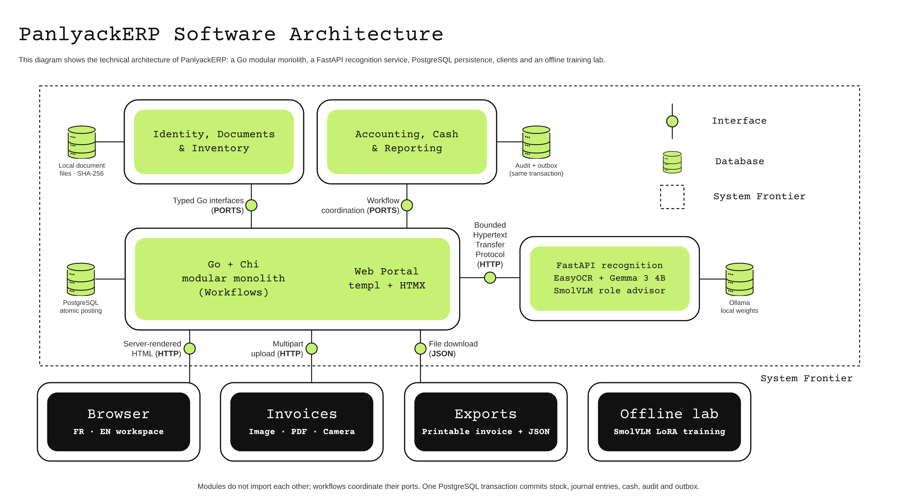
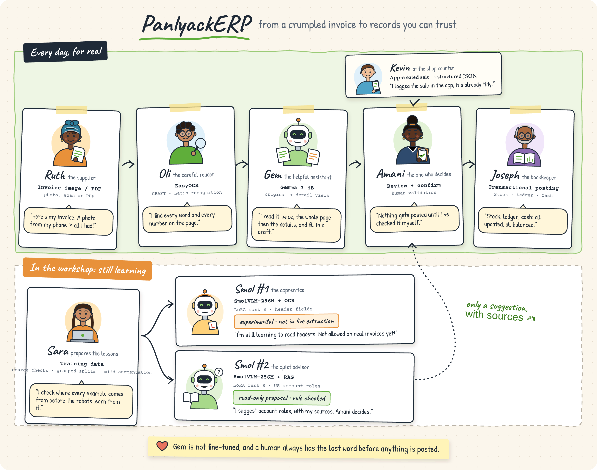

# PanlyackERP: Turning One Reviewed Invoice into Consistent Business Records

*An open-source ERP for small businesses where AI suggests, a person decides, and the database records it once.*

**Joy** · 18 October 2026 · [GitHub](https://github.com/joeylukoji/PanlyackErp) · Apache-2.0 · Go · PostgreSQL · FastAPI

## In 30 seconds

**Problem.** In a small business, one purchase is often typed four times: into an invoice folder, a stock sheet, a cashbook and a ledger. Each re-entry is a chance for the records to disagree.

**Idea.** Capture the invoice once. A local AI pipeline proposes its fields, a person confirms them, and a single database transaction posts stock, accounting entries and payments together.

**Status.** A working local MVP with end-to-end tests, plus two small fine-tuning experiments. The AI parts are honest prototypes; the consistency guarantees are the core contribution.

## Abstract

PanlyackERP is a modular ERP built around a single reviewed document. Recognition (EasyOCR and a locally served Gemma 3 4B model) turns an invoice image or PDF into draft fields; a person reviews and confirms them; a deterministic PostgreSQL transaction then updates inventory, the double-entry journal and cash at the same time. Posting is idempotent and posted records are immutable. Two LoRA experiments on SmolVLM-256M explore whether a very small model can help with invoice headers and account suggestions on an 8 GB laptop GPU. This report describes what is implemented, what was measured and, just as importantly, what has not been shown: it makes no claim of general invoice accuracy or certified accounting compliance.

## 1. The problem: reading is not recording

Recognizing the text on an invoice is only the first step. Real errors happen one level higher: the supplier's name is taken for the customer's, a quantity is swapped with a unit price, or an unpaid invoice is treated as proof of payment. Even perfectly extracted fields do not tell you the purpose of a purchase, its tax treatment or which stock movement it should cause.

So the engineering goal of PanlyackERP is not "perfect OCR". It is a traceable path from uncertain document evidence to explicitly approved, internally consistent records. Every number in the books should be traceable back to a document, and every document should change the books exactly once.

The system handles two kinds of input differently. External documents (supplier invoices and expense receipts) arrive as an uploaded image, a PDF or a browser-camera photo, and go through recognition. Sales created inside the app are already structured, so they skip recognition and directly produce a printable invoice and a downloadable JSON file. Both paths still require confirmation before anything is posted.

## 2. The design principle: suggest → confirm → post

| Step | Responsibility | What happens |
| --- | --- | --- |
| 1 | AI suggests | Recognition produces draft fields only. It has no access to the ERP database and cannot change any record. |
| 2 | A person confirms | The reviewer sees the draft, any arithmetic warnings and the source page, then corrects and approves it. |
| 3 | The database posts | One transaction writes stock, balanced journal entries, payments and an audit trail — all or nothing. |

This separation is deliberate: models may be wrong, but they are never allowed to be authoritative. Everything that changes the books is deterministic code that can be tested.

## 3. Architecture and consistency guarantees

PanlyackERP is a Go modular monolith (Chi router, templ templates, HTMX and Tailwind) backed by PostgreSQL, with a separate FastAPI recognition service. Pages are rendered on the server, so business state stays on the server, and the interface is available in French and English. Identity, documents, inventory, accounting, cash and reporting are separate modules that never import each other; workflows coordinate them through explicit interfaces ("ports"), following the ports-and-adapters idea [1].



*Figure 1. Application architecture. Commands from a signed-in session enter Go workflows. A single PostgreSQL transaction commits the posting effects, the audit record, a persisted outbox record and the dashboard projection. The recognition service only returns read-only suggestions. (The outbox is persisted but has no asynchronous dispatcher yet.)*

[Original architecture SVG](assets/application-architecture.svg).

The posting workflow gives five concrete guarantees:

- **Atomic.** Stock movements, balanced journal lines and payments are committed in one database transaction [2]; either all of them happen or none do. An outbox record is written in the same transaction, the standard way to publish events without losing or duplicating them [3].

- **Gated.** Posting locks the invoice row and refuses any invoice that is not in the confirmed state [4].

- **Idempotent.** Retrying an already-posted invoice produces no duplicate effects, and every later settlement carries its own idempotency key, so a double click or a network retry cannot pay twice [5].

- **Exact.** Money travels as decimal strings at the boundaries and as exact decimals inside Go, never as binary floating point, which cannot represent most cent values exactly [6].

- **Immutable.** Posted records cannot be edited in the application. In accounting practice, corrections are made with reversing entries rather than by rewriting history [7]; a persisted reversal workflow is on the roadmap.

## 4. How an invoice is read

The live recognition path combines a text detector with a vision-language model, all running locally:

1. **Prepare.** Images are rotated and normalized; PDFs are rasterized within page and size limits.

2. **OCR evidence.** EasyOCR [8], which uses the CRAFT text detector [9], reads French and English text from five automatically chosen, overlapping views and keeps the position of each word.

3. **Structured proposal.** Gemma 3 4B [10], served locally through Ollama, reads the original page together with the detail evidence from step 2 and fills a fixed JSON schema of header fields and product rows. Gemma is used as-is; it is not fine-tuned in this project.

4. **Arithmetic check.** Exact decimal diagnostics compare line totals, taxes, the invoice total and any stated payments. If they disagree, the model gets at most one corrective re-reading; anything still unresolved is shown to the reviewer instead of being hidden.



*Figure 2. Live workflow vs. experiments. The top lane is the production path. The two SmolVLM adapters below are separate experiments: the invoice-header adapter is not used by the live extractor, and the accounting adapter only offers read-only suggestions that are checked against deterministic rules. Human confirmation precedes every posting.*

[Original illustrated pipeline SVG](assets/invoice-model-pipeline.svg).

## 5. Small-model experiments

Can a very small model help on a consumer laptop? To find out, I trained two LoRA adapters [11] of rank 8 on SmolVLM-256M-Instruct [12]. Only the attention query and value projections are trained; the base weights stay frozen.

### A. Invoice-header adapter

- **Task:** four fields only — invoice number, supplier, printed date and total (no product rows).

- **Data:** 142 training images = 77 original invoices + 65 mild photometric variants; 8 originals for validation; 108 further documents held back.

- **No leakage:** hash and invoice-identity checks keep every original together with its variants in the same split [13].

- **Training:** BF16, batch size 1 with 4-step gradient accumulation, learning rate 1e-4, 3 epochs.

- **Caveat:** labels are supplied synthetic targets, not human-verified ground truth.

### B. Account-role adapter + retrieval

- **Task:** suggest the US accounting role of a transaction (read-only).

- **Data:** 184 synthetic training cases, 46 validation, 46 held-out tests, each with distinct product descriptions.

- **Retrieval:** a lightweight, retrieval-augmented setup [14] using operation filters, structural matching and word overlap [15] - no vector database. At most four sources enter a prompt: training examples, six reference cards and selected public accounting vocabulary.

- **Training:** 4 epochs, loss on the target tokens only.

## 6. What the measurements show

All runs used one laptop: Ryzen 7 8845HS, about 16 GB RAM and an RTX 4060 Laptop GPU with 8 GB VRAM.

Training and the full application were never run at the same time. Model hashes, split checks and saved reports distinguish a completed experiment from a merely prepared dataset.

| Experiment (validation set) | Observed result | Honest reading |
| --- | --- | --- |
| Header adapter, image only (n = 8) | Valid JSON 5/8 · number 0/8 · supplier 2/8 · date 4/8 · total 1/8 | Not good enough to extract invoices |
| Header adapter, image + OCR text (n = 8) | Valid JSON 8/8 · number 3/8 · supplier 5/8 · date 8/8 · total 5/8 exact (6/8 after decimal normalization) | Encouraging, but a tiny synthetic pilot |
| Account-role adapter + retrieval (n = 46) | Schema-valid and exact role match 46/46 | Checks structure on synthetic data, not real accounting accuracy |

Table 1. Validation results. Neither held-out test partition has been evaluated yet.

On the image + OCR run, teacher-forced validation loss fell from 1.585 to 0.363, peak GPU memory was 5.76 GiB, and the adapter file is only 1.86 MB (1,860,096 bytes, excluding the base model and processor files). The accounting run peaked at 2.65 GiB. So fine-tuning a 256M-parameter model is practical on an 8 GB laptop GPU.

**What these numbers do not prove.** The two header runs differ in more than the OCR input (augmentation and exposure also changed), so they do not isolate the benefit of OCR or of fine-tuning. Reused layouts, cropped supplier headings and repeated accounting structures limit generalization; benchmarks with unseen layouts show this is exactly where extractors tend to fail [16]. Product-line recognition has no independent accuracy estimate yet.

## 7. End-to-end walkthrough

A fictional demo checks that the workflows are wired together correctly. A new workspace starts with 5,000 USD of synthetic cash.

| # | Event | What gets recorded |
| --- | --- | --- |
| 1 | Buy 10 keyboards for 250 USD (25 each); pay 150 now | Inventory +250; cash -150; supplier payable 100 remains open |
| 2 | Sell 2 keyboards at 40 each, plus 8% sales tax | Revenue 80; sales tax 6.40 kept separate from revenue; invoice total 86.40; cost of goods sold 50; inventory -50 |
| 3 | Customer pays 50 in cash, then 36.40 by bank transfer | Receivable fully settled through two idempotent settlements |

| Stock | Inventory | Revenue | COGS | Cash | Bank | Payable |
| --- | --- | --- | --- | --- | --- | --- |
| 8 units | 200.00 | 80.00 | 50.00 | 4,900.00 | 36.40 | 100.00 |

Table 2. Demo scenario and final balances (USD). The books balance: assets 5,136.40 = liabilities 106.40 (payable 100 + sales tax 6.40) + equity 5,030 (opening 5,000 + profit 30). The sale is also exported directly as structured JSON.

This verifies connected workflow behaviour, not recognition accuracy or whether a given tax actually applies.

## 8. How this relates to existing work

**Document AI.** Layout-aware pre-trained models such as LayoutLM and LayoutLMv3 [17, 18] combine OCR text with its position on the page, while OCR-free models such as Donut and Pix2Struct [19, 20] read the image directly. Progress is usually measured on receipt and invoice benchmarks such as SROIE, CORD, FATURA and DocILE [21-23, 16]. More recently, general multimodal LLMs, including Gemma 3, have been benchmarked zero- shot on invoices, and feeding them the page image generally worked better than converting the document to text first [24], consistent with PanlyackERP letting Gemma see the page itself. These models can still invent values on degraded documents [25], and schema-constrained decoding guarantees the shape of the output, not its correctness [26]. A recent multi-agent invoice pipeline reached 98.5% document-level accuracy on a 100- document subset once selective human validation was added [27].

**Where PanlyackERP differs.** Most of this work asks how accurately can we extract? PanlyackERP asks what may an extraction be allowed to change? It treats model output strictly as a proposal and relies on established engineering patterns — balanced transactions whose entries sum to zero [28], reversing entries, idempotency keys and the transactional outbox — so that a hallucinated value cannot reach stock, the ledger or cash without a person approving it.

## 9. Scope and known limits

Tax policy. A bounded US policy capitalizes non-recoverable purchase tax into inventory cost and keeps buyer-paid sales tax out of revenue. The operator decides purpose, jurisdiction, rate and payment evidence.

Out of scope. Tax filing, nexus, exemptions, bank reconciliation and certified compliance.

Rounding. A 0.002 discrepancy between printed cents and exact arithmetic remains an explicit, documented policy gap.

Deployment. The app is a local MVP bound to the loopback interface with production mode disabled; it is not yet a multi-user hosted service.

## 10. Try it and contribute

The repository contains the source, database migrations, tests, training scripts, report excerpts and reproduction instructions [29]. Local invoices, credentials and model weights are deliberately excluded. To run it with Docker:

```sh
cp .env.example .env        # then fill in the secret placeholders
docker compose --env-file .env -f deployments/compose.yaml up --build -d
# open http://127.0.0.1:8080/register
```

The roadmap is also a list of good places to help this Hacktoberfest:

| Area | Contribution | Goal |
| --- | --- | --- |
| Data | Human-verified reference labels | Correct visible invoice fields with the annotation workbench to replace synthetic targets. |
| ML evaluation | Unseen supplier and layout tests | Evaluate the held-out partitions and new layouts the models have never seen. |
| Accounting | Independent accounting benchmark | A reviewed set of cases to measure account suggestions against real practice. |
| Backend | Reversal and rounding workflows | Reversing entries for posted records and a clear policy for printed-cent rounding. |
| Backend | Outbox dispatcher | Deliver persisted outbox records asynchronously. |
| Security | Production identity hardening | Teammate invitations, roles, password recovery, rate limits and HTTPS deployment. |

The core contribution is an auditable separation between what a model suggests and what the business records: AI can make data entry faster, but only confirmed, deterministic transactions change the books.

## References

1. A. Cockburn. "Hexagonal Architecture" (Ports and Adapters). HaT Technical Report 2005.02, 2005. [Source](https://alistair.cockburn.us/hexagonal-architecture)
2. PostgreSQL Global Development Group. "Transactions", PostgreSQL 18 Documentation, §3.4. [Source](https://postgresql.org/docs/18/tutorial-transactions.html)
3. C. Richardson. "Pattern: Transactional outbox", microservices.io; see also Microservices Patterns, Manning, 2018. [Source](https://microservices.io/patterns/data/transactional-outbox.html)
4. PostgreSQL Global Development Group. "Explicit Locking: Row-Level Locks", PostgreSQL 18 Documentation, §13.3.2. [Source](https://postgresql.org/docs/18/explicit-locking.html)
5. B. Leach. "Designing robust and predictable APIs with idempotency", Stripe Blog, 22 Feb 2017. [Source](https://stripe.com/blog/idempotency)
6. D. Goldberg. "What Every Computer Scientist Should Know About Floating-Point Arithmetic", ACM Computing Surveys 23(1):5-48, 1991. [doi:10.1145/103162.103163](https://doi.org/10.1145/103162.103163)
7. M. Fowler. "Reversal Adjustment", 2006, in Patterns for Accounting. [Source](https://martinfowler.com/eaaDev/ReversalAdjustment.html)
8. JaidedAI. EasyOCR, version 1.7.2 (Apache-2.0). [Source](https://github.com/JaidedAI/EasyOCR)
9. Y. Baek, B. Lee, D. Han, S. Yun, H. Lee. "Character Region Awareness for Text Detection", CVPR, pp. 9365-9374, 2019. [arXiv:1904.01941](https://arxiv.org/abs/1904.01941)
10. Gemma Team. "Gemma 3 Technical Report", 2025. [arXiv:2503.19786](https://arxiv.org/abs/2503.19786)
11. E. J. Hu, Y. Shen, P. Wallis, Z. Allen-Zhu, Y. Li, S. Wang, L. Wang, W. Chen. "LoRA: Low-Rank Adaptation of Large Language Models", 2021. [arXiv:2106.09685](https://arxiv.org/abs/2106.09685)
12. A. Marafioti et al. "SmolVLM: Redefining small and efficient multimodal models", 2025. [arXiv:2504.05299](https://arxiv.org/abs/2504.05299)
13. S. Kapoor, A. Narayanan. "Leakage and the reproducibility crisis in machine-learning-based science", Patterns 4(9):100804, 2023. [doi:10.1016/j.patter.2023.100804](https://doi.org/10.1016/j.patter.2023.100804)
14. P. Lewis et al. "Retrieval-Augmented Generation for Knowledge-Intensive NLP Tasks", NeurIPS 33, pp. 9459-9474, 2020. [arXiv:2005.11401](https://arxiv.org/abs/2005.11401)
15. S. Robertson, H. Zaragoza. "The Probabilistic Relevance Framework: BM25 and Beyond", Foundations and Trends in Information Retrieval 4(1-2):1-174, 2009. [doi:10.1561/1500000019](https://doi.org/10.1561/1500000019)
16. Š. Šimsa et al. "DocILE Benchmark for Document Information Localization and Extraction", ICDAR, 2023. [arXiv:2302.05658](https://arxiv.org/abs/2302.05658)
17. Y. Xu, M. Li, L. Cui, S. Huang, F. Wei, M. Zhou. "LayoutLM: Pre-training of Text and Layout for Document Image Understanding", KDD, 2020. [doi:10.1145/3394486.3403172](https://doi.org/10.1145/3394486.3403172)
18. Y. Huang, T. Lv, L. Cui, Y. Lu, F. Wei. "LayoutLMv3: Pre-training for Document AI with Unified Text and Image Masking", ACM Multimedia, pp. 4083-4091, 2022. [doi:10.1145/3503161.3548112](https://doi.org/10.1145/3503161.3548112)
19. G. Kim et al. "OCR-Free Document Understanding Transformer", ECCV, 2022. [arXiv:2111.15664](https://arxiv.org/abs/2111.15664)
20. K. Lee et al. "Pix2Struct: Screenshot Parsing as Pretraining for Visual Language Understanding", ICML, PMLR 202, pp. 18893-18912, 2023. [arXiv:2210.03347](https://arxiv.org/abs/2210.03347)
21. Z. Huang et al. "ICDAR2019 Competition on Scanned Receipt OCR and Information Extraction", ICDAR, 2019. [doi:10.1109/ICDAR.2019.00244](https://doi.org/10.1109/ICDAR.2019.00244)
22. S. Park et al. "CORD: A Consolidated Receipt Dataset for Post-OCR Parsing", NeurIPS Workshop on Document Intelligence, 2019. [Source](https://openreview.net/forum?id=SJl3z659UH)
23. M. Limam, M. Dhiaf, Y. Kessentini. "FATURA: A Multi-Layout Invoice Image Dataset for Document Analysis and Understanding", 2023. [arXiv:2311.11856](https://arxiv.org/abs/2311.11856)
24. D. Berghaus, A. Berger, L. Hillebrand, K. Cvejoski, R. Sifa. "Multi-Modal Vision vs. Text-Based Parsing: Benchmarking LLM Strategies for Invoice Processing", 2025. [arXiv:2509.04469](https://arxiv.org/abs/2509.04469)
25. Z. He et al. "Seeing is Believing? Mitigating OCR Hallucinations in Multimodal Large Language Models", 2025. [arXiv:2506.20168](https://arxiv.org/abs/2506.20168)
26. B. T. Willard, R. Louf. "Efficient Guided Generation for Large Language Models", 2023. [arXiv:2307.09702](https://arxiv.org/abs/2307.09702)
27. D. Gosmar, G. Zenezini. "MADP: A Multi-Agent Pipeline for Sustainable Document Processing with Human-in-the-Loop", 2026. [arXiv:2605.17159](https://arxiv.org/abs/2605.17159)
28. M. Fowler. "Accounting Transaction", 2005. [Source](https://martinfowler.com/eaaDev/AccountingTransaction.html)
29. Joy. PanlyackERP: source, migrations, tests, training scripts and publication material (Apache-2.0). [Source](https://github.com/joeylukoji/PanlyackErp)
